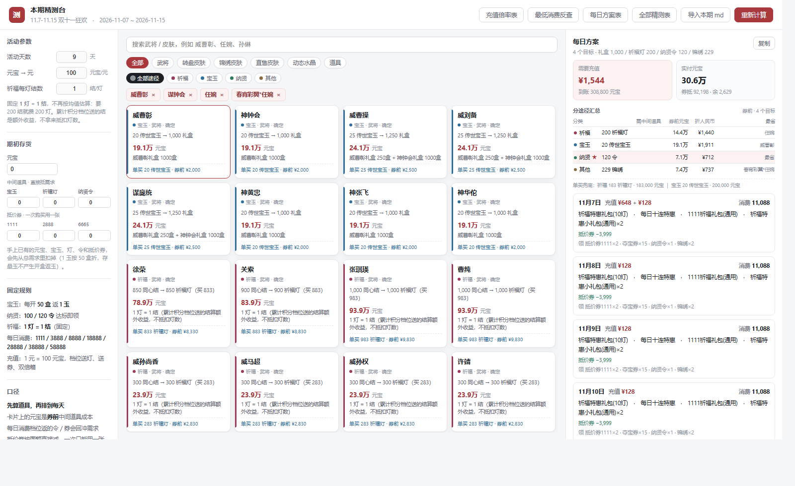
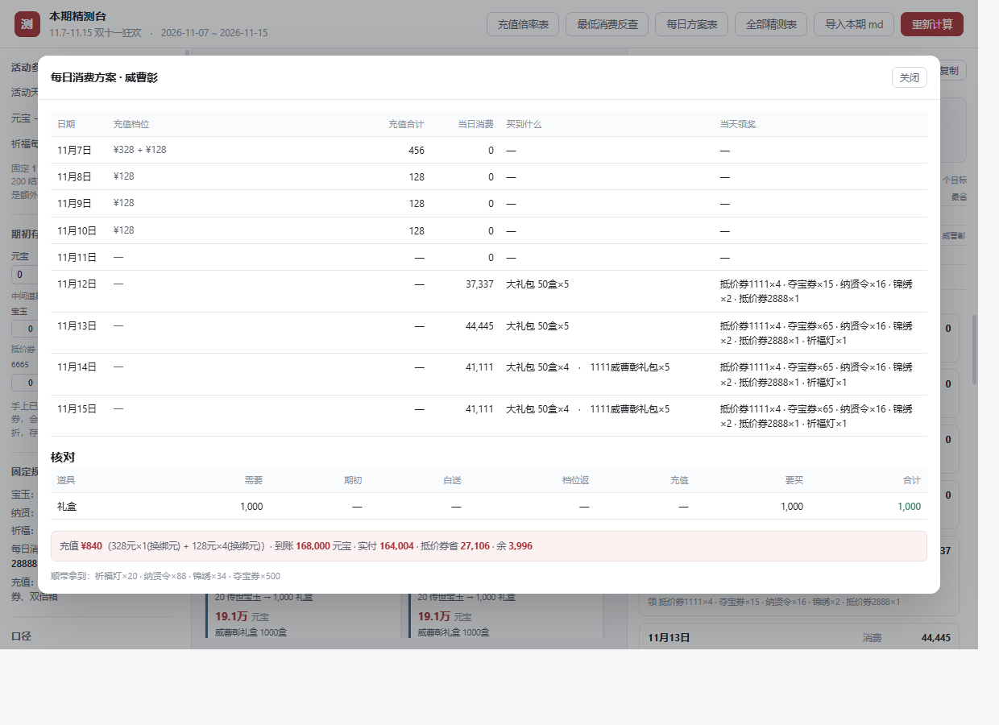
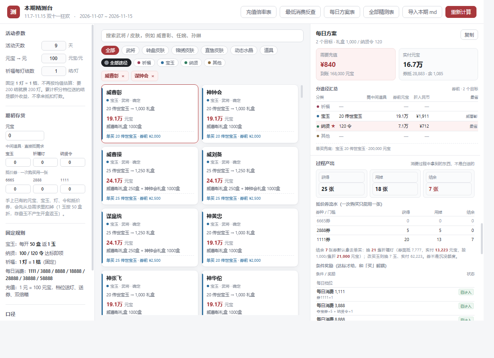
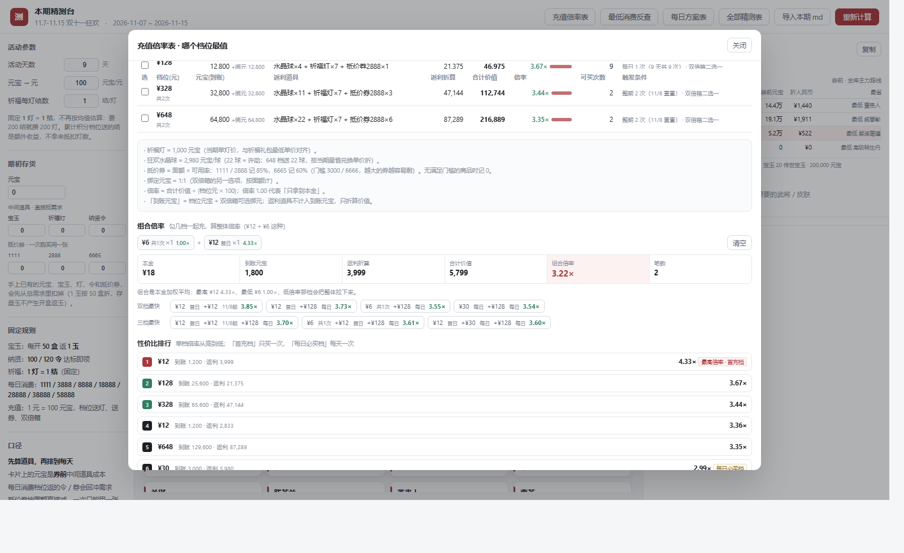
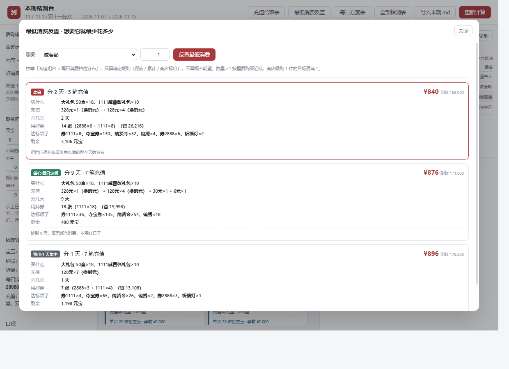

# 三国杀十周年 · 活动精测台

> **不算概率，只算保底。** 把「想要哪个武将 → 要买多少中间道具 → 花多少元宝 → 哪天充、哪天花 → 用掉几张券」算成一张照着买就行的表。



纯前端、零依赖、零构建。双击 `index.html` 就能跑，不联网、不上传任何数据。

[](LICENSE)
[](#)
[](tools/check.js)

---

## ⚠️ 先看这段

这是一个**灵感随机一动**的小开发——为了算清楚自己这一期活动到底要花多少钱，临时起意写的。

**没有做过多次验证，样本集有限**：数据来自官网公告 + 少量社区实测，口径靠人工逐条核对，没有拿真实充值流水跑过回归。数字只代表「写代码时的这套参数 + 这一期公告」下的估算，官方改规则、改档位、改掉落概率，或者我看漏了一条限购，结果就会偏。

**不构成任何消费建议。** 照着买之前，请自己把关键档位和限购复核一遍。
觉得哪里算得不对，欢迎[开 issue](https://github.com/Cloudyunpianer/sgs_jingce/issues/new/choose)打脸。

---

## 这是什么

大多数「这武将多少钱」的攻略给你一个区间，它的依据是概率期望——玄学、不可复现、也没法照着执行。

这个工具换了个思路：**只走确定路径**。

```
目标  →  需要多少个中间道具（公告写死的档位）  →  这些道具花多少元宝  →  充值怎么组合最便宜
```

礼盒按保底算（50 盒 = 1 玉），祈福按 1 灯 = 1 结算，纳贤按 100/120 达标算，抽不到的路线直接灰显不给结论。中间再叠上每日消费档位返利、抵价券、充值档位双倍箱，再把购买量**按每日预算摊到天**（每日重置的档位只能一天吃一份），最后出一张逐日日程表。

**它回答的是「我这期要花多少钱、具体怎么花」，不是「这武将值多少钱」。**

## 它不做什么

诚实说明边界，免得你拿着它做错误决策：

- **不预测概率**：0.005% 开盒出武将这类路线，只灰显参考，不进方案
- **不追活动之外的成本**：只算本期商城能买到的东西，你手里已有的资产另填「期初存货」
- **不保证公告解读无误**：限购次数、档位门槛都可能看漏，导入公告后请自己扫一眼
- **不做账号操作**：纯本地计算器，不登录、不接游戏 API

### 换期解析的边界（2026-11-20 更新）

公告导入现在能覆盖「纳贤 / 珍宝礼盒 / 珍宝商店 / 夺宝转盘 / 祈福 / 锦绣 / 签筒 / 如意商城 / 皮肤直售 / 限时商品 / 单笔充值 / 累计充值 / 每日消费 / 累计消费 / 抵价券」这些板块，**不认专名**（寒露夺宝券、重阳夺宝券都归一到「夺宝券」）。

仍然不支持的：

- **五种玩法**：群英绘卷、幸运砸蛋、欢乐连连看、福喵纳财、积惠特卖。导入时会列进「未纳入精算」，说明公告里有但没建模。
- **累计充值奖励**：解析出来只做展示，不参与最优解——这类奖励多是宝箱，折算价值太主观。
- **内置双十一数据仍是手工口径**：勋章产出算白送、勋章价格未计入成本。导入当期会用严格口径（勋章算「需购买」），两边会有差异，这是已知的。

十一期实测结果见 [十一期回测](docs/十一期回测.md)，样本在 [`samples/`](samples/)。

## 功能

| 功能 | 说明 | 入口 |
|---|---|---|
| **分途径分组** | 133 个目标按 祈福 / 宝玉 / 纳贤 / 其他 四类归位，带色标和筛选 | 中栏 chips |
| **分途径汇总** | 四类各需多少中间道具、券前元宝、折人民币，★ 标最省 | 右栏顶部 |
| **逐日方案表** | 哪天充多少、当天花多少、买什么、领什么奖 | 右栏 / 「每日方案表」 |
| **过程产出** | 抵价券流水（获得/用掉/结余）+ 达标条件奖励三态标注 + 免费到手 | 右栏下方 |
| **充值分析** | 横向拆方案：通元 / 绑元 / 红包 / 券 / 灯宝玉 / 纳贤令 / 15-1，配三个倍率（产出算不算数）+ 含消费口径 | 顶栏「充值倍率表」 |
| **先充后选** | 先定充值组合，直接看这组产出能覆盖谁；勾完生成方案，充值锁定不再改 | 充值分析里「选将 →」 |
| **最低消费反查** | 给定目标，枚举天数分布 × 充值组合，出 Top3（最省 / 省心 / 快出） | 顶栏「最低消费反查」 |
| **期初存货** | 已有元宝、传世宝玉、祈福灯、纳贤令、抵价券先抵扣 | 左栏 |
| **单买兜底** | 祈福灯 1,000 / 玉 10,000 元宝（保底折算），多余券默认换这些 | 卡片 / 汇总表 |
| **公告导入** | 扔一份官网公告 md，自动解析本期数据 | 顶栏「导入本期 md」 |

### 几个界面

| 逐日方案表 | 过程产出（券流水 + 条件奖励） |
|---|---|
|  |  |

| 充值分析 + 先充后选 | 最低消费反查 |
|---|---|
|  |  |

## 快速开始

**不需要装任何东西。** 没有 Node、没有 npm、没有构建步骤。

```bash
git clone https://github.com/Cloudyunpianer/sgs_jingce.git
```

然后：

- **Windows**：双击 `启动精测.bat`（用 Edge 应用窗口打开，像个独立软件）
- **任何系统**：直接双击 `index.html`，或拖进浏览器

> 用 `file://` 直开的，`fetch` 读不了本地文件，所以「导入本期 md」用的是文件选择框 + FileReader，不依赖服务器。

### 三分钟上手

1. **左栏**填期初存货（没有就留 0）和活动天数
2. **中栏**点选要的武将 / 皮肤，可以多选，同池道具会合并计算
3. **右栏**看结果：上面是「要充多少钱」，下面是逐日买什么
4. 想核对就点「每日方案表」，看那张「需要 / 期初 / 白送 / 档位返 / 要买 / 合计」的核对表
5. 想反着问「我只有 300 块能拿哪个」，点顶栏「最低消费反查」

## 一个例子

本期回归用的五个基准目标（改代码后必须还是这几个数，否则说明算错了）：

| 目标 | 途径 | 中间道具 | 券前元宝 | 券后实付 | 充值组合 |
|---|---|---:|---:|---:|---|
| 威曹彰 | 宝玉 | 传世宝玉 ×20（= 1,000 盒） | 191,110 | **¥832** | ¥328 ×2 + ¥128 ×1 + ¥30 + ¥12 + ¥6 |
| 谋钟会 | 纳贤 | 纳贤令 ×120 | 54,177 | **¥280** | ¥128 ×2（换绑元）+ ¥12 ×2 |
| 任婉 | 祈福 | 同心结 ×200（= 200 灯） | 144,031 | **¥646** | ¥128 ×5（换绑元）+ ¥6 |
| 春宵彩翼\*任婉 | 其他 | 绸缎 ×192 + 锦绣 ×229 | 70,804 | **¥310** | ¥128 ×2（换绑元）+ ¥30 + ¥12 ×2 |
| 谋程普 | 其他 | 狂欢水晶球 ×11 | 32,800 | **¥328** | ¥328 ×1 |

「券前」是道具成本，「券后」是叠完每日档位返还和抵价券之后的实际掏钱数。两者差得远，是因为活动本身返了不少券和道具。

> 谋程普那 ¥328 其实是「买球」不是「消费」：¥328 档送 11 颗水晶球正好换将，充进去的 32,800 元宝一分没花，留着下期用。
>
> 双倍箱档位标「换绑元」的，是「同样这一笔钱，换绑元比拿道具包划算」——
> 128 元换 25,600 绑元，或拿 11 球 + 7 灯 + 1 张券。当单只要宝玉/纳贤令时后者折不出 128 元，
> 所以选绑元。这一判断与「充值分析」表的路线选择同源，不叠加、不重复计。

## 口径

只列最关键的，完整推导见 [`docs/methodology.md`](docs/methodology.md)。

- **1 元 = 100 元宝**
- **礼盒**：每累计开 50 盒返 1 传世宝玉（保底），所以 20 玉 = 1,000 盒
- **祈福**：1 灯 = 1 结（取最保守口径；累计积分档位额外返的结算白赚，不抵扣灯数）
- **纳贤**：累计 100 / 120 令达标即领
- **抵价券**：一次购买只能用一张，门槛 3,000 / 6,666
- **档位返利按券后消费判定**（券减免的部分不计入消费），比按原价算更保守
- **中间产物闭环**：充值返的灯 / 令 / 锦绣 / 券会真的抵掉当单需求（少买、少花、再少充），
  不是只写在核对表里；返得到的量按「只减不增」迭代到不动点，假设永远不超过实际
- **双倍箱二选一**：128 / 328 / 648 三档是「道具包 **或** 换绑元」，两条路线分别算价值取高的那条，
  绝不叠加——早先的版本两条一起给，¥128 档倍率因此虚高到 3.67×

### 里面有几个纯手工估的参数

| 参数 | 取值 | 为什么 |
|---|---|---|
| 祈福每灯结数 | 1 结 / 灯 | 公告只给累计档位，取最保守的 1:1 |
| 单买祈福灯 | 1,000 元宝 / 盏 | 商城单灯价，用作券的去处和兜底价 |
| 单买传世宝玉 | 10,000 元宝 / 个 | 50 盒保底 1 玉 × 200 元宝折算，非真实售价 |
| 抵价券可用率 | 1111/2888 记 85%、6665 记 60% | 估的，大额券更难凑门槛 |
| 绸缎掉率 | 0.84 / 抽 | 公告给「8% 概率掉 6~15」，无保底，取期望 |

改这些在 `js/data.js` 的 `params` / `singles` 里。

## 换期怎么用

点「导入本期 md」→ 选官网公告 markdown → 弹窗逐条确认 → 应用。数据存在浏览器本地，可以「恢复内置」。

导入会**整期替换**：解析不到的板块一律清空，不会留着上一期的礼盒/祈福/转盘。弹窗里会列出「本期公告未找到」和「未纳入精算的玩法」。

少数情况仍要手改 `js/data.js`：活动玩法本身变了（比如新增砸蛋）、或者你需要把某段公告的解读口径改成自己的。详见 [`docs/data.md`](docs/data.md)。

## 自检

```bash
node tools/check.js
```

304 项断言，覆盖：五个基准目标回归、四类覆盖、抵价券守恒（获得 = 用掉 + 结余）、倍率单调、反查 ≤ 单买、单买价、结余换购守恒、组合倍率加权、期初存货抵扣、皮肤分类，中间产物六道闸（到账够花 / 逐项不缺料 / 返利假设 ≤ 实际 / 双倍箱不叠加 / 夺宝兑换不超券量 / 绑元红包返利进表），一组「虚构期」的换期解析测试（去专名、券面额、勋章口径、未建模玩法标记），以及纳贤双池（标准纳贤 vs 海纳百川/特惠精选 k 选 1）的路线区分、纳贤令折算价不打折、每日累计充值门槛对齐实际档位、右栏到账口径（到账 = 可花本金 + 红包返利 + 福喵返利 + 可选首充双倍，绑定元宝不双算），¥132 锁定充值专项（收敛选解 / 方案完整 / 返利进可花总额 / 缺口清零 / 首充双倍默认关），限1次奖励不重复参与专项（`onceGives` 分离 / 倍率只计1份 / 可重复部分仍累乘），阶梯推荐方案专项（纯绑元大档 prefCap=1 / 带券令档可多次 / 真实 cap 不被改动 / 单档不超推荐上限），自选福袋折算专项（按最高价值项折算 / sel15 列 / 只作用于充值档不污染消费档），消费节奏对比专项（三种策略 / 分天命中更多档 / 顶门槛不退化成一次性），消费送宝玉补档专项（4 档解析 / 门槛→玉数 / 补档差额 / 已达成标记 / 不混入 cumSpend 回冲），专属纳贤令字段专项（专令识别 / 复合档白送带 only / 首发将比通用将便宜 / 不误折通用令），草船借箭概率武将专项（箭矢期望150 / 概率武将进库不误报无渠道 / 期望抽数 / 补档步骤 / 边际成本0不虚增报价），以及 7 份官网真实样本的解析→报价回归（`samples/`，含天数、目标数、总价）。

改完代码跑一遍，全绿再提交。CI 也会跑（[`.github/workflows/check.yml`](.github/workflows/check.yml)）。

## 目录结构

```
index.html          界面骨架
style.css           全部样式（单文件，无预处理器）
js/
  data.js           本期活动数据：礼包、每日档位、充值档位、商店、直售、单买价目
  engine.js         路线引擎：目标 → 中间道具 → 元宝
  plan.js           排程引擎：摊到每天、档位返利迭代、券、充值组合
  classify.js       目标归类（祈福/宝玉/纳贤/其他）+ 分途径汇总
  rates.js          充值倍率表、组合倍率、凑额 DP
  mincost.js        最低消费反查（下界剪枝）
  parser.js         公告 md 解析
  ui.js             界面逻辑（原生 DOM，无框架）
tools/check.js      node 自检
tools/capture/      油猴内嵌精测台（抓包+导入，构建脚本+模板+产物，见 docs/capture.md）
启动精测.bat        Windows 双击启动
结论-v4.md          本期跑出来的结论表（样例）
PLAN-v4.md          这一版的设计稿
docs/               文档
```

约 4,900 行，无框架无打包，改完刷新就行。

## 文档

- [使用指南](docs/usage.md) —— 每个界面、每个弹窗怎么用
- [口径与算法](docs/methodology.md) —— 每个数字是怎么算出来的
- [数据维护 / 换期](docs/data.md) —— 哪些要手改，导入怎么工作
- [油猴内嵌精测台](docs/capture.md) —— 把完整精测程序嵌进官网页面，抓包后一键导入当期数据出结果
- [代码结构](docs/architecture.md) —— 想改代码看这个
- [常见问题](docs/faq.md) —— 为什么和我算的不一样

## 已知局限

- 没有真实充值流水做回归，只有五个手工核过的基础目标
- 只覆盖本期这一套活动配置，换期要改数据（且可能需要改代码）
- 不建模「通元转绑元」这类游戏内转换（公告没写规则）
- 累计消费里程碑（1w/3w/6w/8.8w）、充值 58888 福袋只作提示，未计入返利
- 只在 Edge / Chrome 上测过，Safari / Firefox 没试
- 界面是给自己用的，窄屏（< 1280px）会挤

## 参与

欢迎[提 issue](https://github.com/Cloudyunpianer/sgs_jingce/issues)报错数、指口径、补新期数据。改代码前先看 [CONTRIBUTING.md](CONTRIBUTING.md)。

## 许可

[MIT](LICENSE)。数据与结论仅供参考，游戏内容版权归游卡所有。
