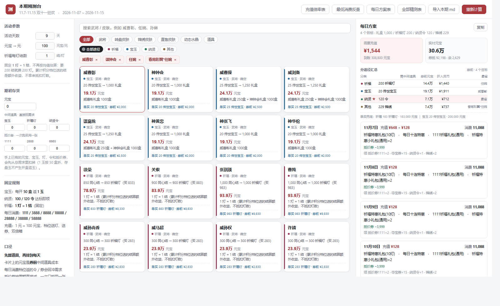
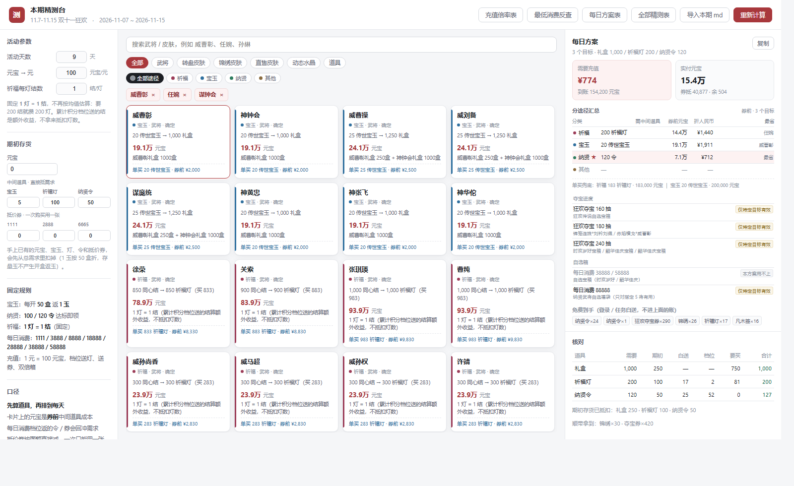
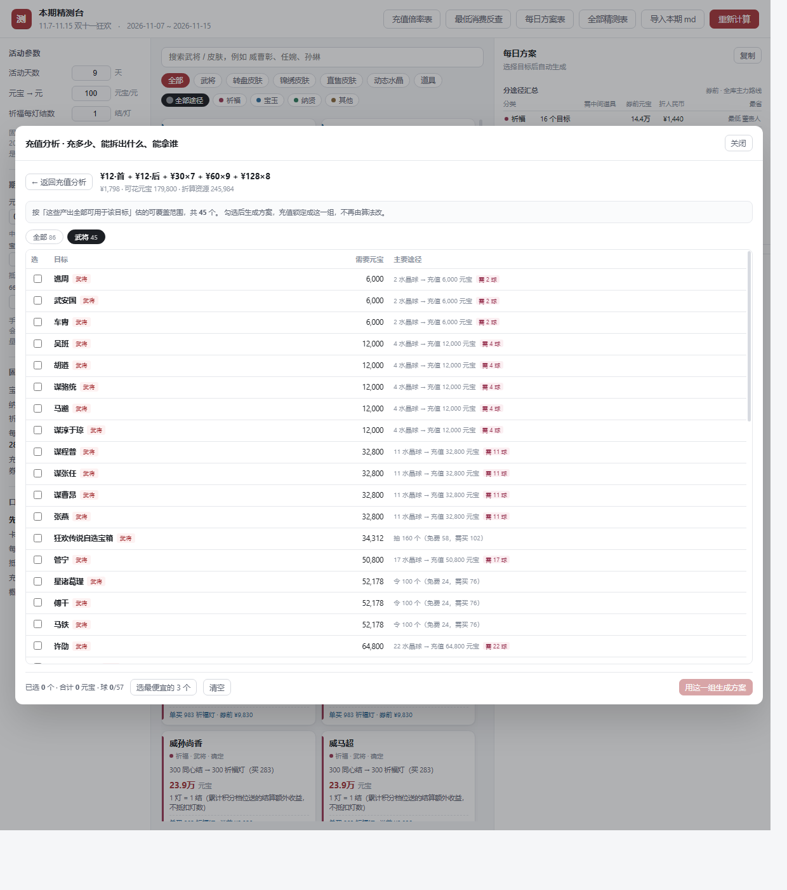
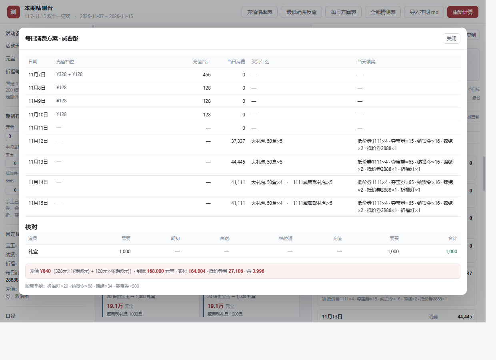
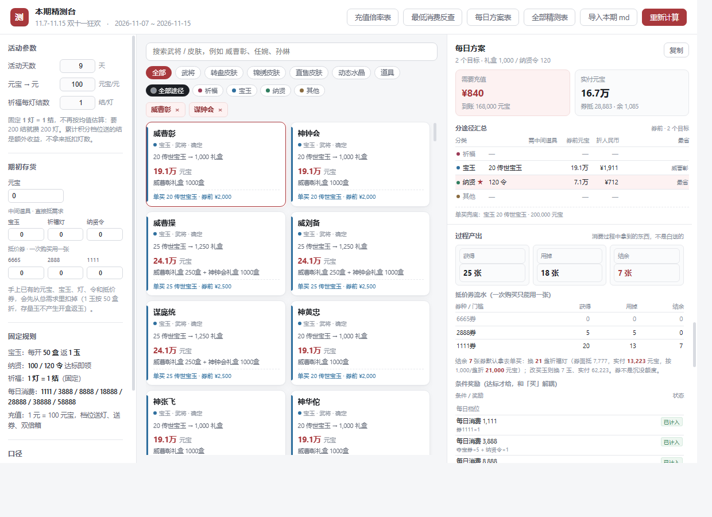
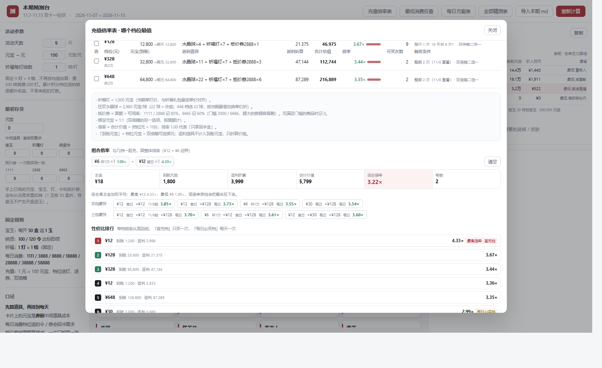
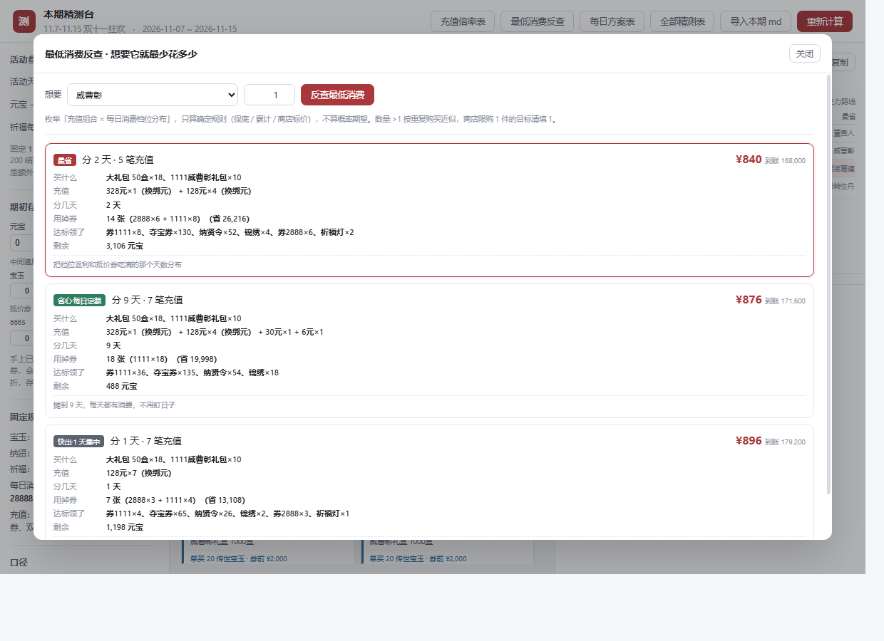

# 使用指南

面向「打开就想用」的人。想看数字怎么来的，去 [口径与算法](methodology.md)。

---

## 打开

| 方式 | 说明 |
|---|---|
| 双击 `启动精测.bat` | Windows，用 Edge 应用窗口打开，像个独立小软件 |
| 双击 `index.html` | 任意系统，默认浏览器打开 |

不需要装 Node、不需要起服务器、不需要联网。数据全在本地，不会上传任何东西。

---

## 界面总览



三栏：

- **左**：参数和期初存货（你手上有什么）
- **中**：目标清单（你想要什么）
- **右**：结果（要花多少、怎么花）

---

## 左栏 · 参数与存货

### 活动参数

| 项 | 说明 |
|---|---|
| 活动天数 | 默认 9 天。决定每日档位最多能领几次、充值「每日 1 次」的档位能买几次 |
| 元宝 → 元 | 默认 100，即 1 元 = 100 元宝。改这个会整体缩放人民币结果 |
| 祈福每灯结数 | **只读固定 1**。要 200 结就攒 200 灯 |

### 期初存货



分两组：

**中间道具（直接抵需求）**

- **元宝**：先从最终充值额里扣
- **宝玉**：1 玉抵 50 盒。注意存量玉**不产生开盒返玉**，所以抵的是盒数
- **祈福灯**：1:1 抵灯
- **纳贤令**：1:1 抵令

**抵价券（一次购买用一张）**

- 1111 / 2888 / 6665 三种，进券池和活动给的券一起排

填完自动重算右栏。想验证抵扣对不对，看右栏「核对」表的**期初**列。

---

## 中栏 · 选目标


### 两个筛选维度

**第一行：类型**

`全部` / `武将` / `转盘皮肤` / `锦绣皮肤` / `直售皮肤` / `动态水晶` / `道具`

皮肤按获取途径分开，因为算钱方式完全不同——转盘靠抽（保底 100），锦绣靠绸缎，直售是一口价。

**第二行：获取途径**

`全部` / `祈福` / `宝玉` / `纳贤` / `其他`，带四色圆点。点一下只显示主力走这条路的武将。

### 卡片怎么读

```
┌─────────────────────────┐
│▌威曹彰              [宝玉]│   ← 左侧色条 = 途径，右上 = 分类
│  20 传世宝玉 = 1,000 盒    │   ← 中间道具
│  191,110 元宝            │   ← 券前成本
│  礼盒保底，确定            │   ← 口径说明
│  路线 3                  │   ← 有其他获取方式，点开看
│  备选：纳贤 120 令 · 券前 ¥712 │   ← 其他途径的对比
└─────────────────────────┘
```

卡片上永远是**券前**（道具成本），不是券后。想知道实际掏多少钱看右栏——因为券后要等你把多个目标放一起才能算（券和档位会合并）。

点卡片 = 选中 / 取消。可以多选，同池道具自动合并。

### 路线弹窗

点卡片上的「路线 N」：

| 列 | 含义 |
|---|---|
| 怎么拿 | 这条路径的说明 |
| 需要道具 | 总需求 |
| 需购买 | 扣掉白送之后要买的 |
| 元宝 / ≈元 | 券前成本 |
| 口径 | 确定 / 均值 / 概率 |
| 采用 | 强制走这条路（覆盖自动最优） |

灰掉的是纯概率路线，仅供参考，不参与计算。表底有「单买兜底」行，是礼包限购买完之后的价格上限。点「恢复自动最优」撤销手动选择。

---

## 先定充值，再挑武将

顶栏「充值倍率表」里那张横向表就是入口。

1. 表里每行是一个充值方案：金额、总元宝，再按品类拆开（通元 / 绑元 / 红包 / 抵价券 / 灯宝玉 / 纳贤令 / 15-1 / 其他）。
2. 右边三个倍率只差在「这些产出对你要的武将算不算数」：拿 15-1 全算、拿非 15-1 扣掉 15-1、不拿纳贤再扣纳贤令。最后一列「含消费」把消费返利也加进来。
3. 看中哪行点「选将 →」，会列出这组产出能覆盖的目标，按需要元宝从少到多排。勾完点「用这一组生成方案」。
4. 生成后充值就**锁定**成这一组，右侧顶部有提示条可一键解除。球不够会直接禁用按钮并写明还差几个——水晶球只能从充值档送，预算够也补不了。



「选将」页按「这组产出够不够」列目标，球不够会直接禁用并写明还差几个。

想自己配就在下面「自己配」里勾档位、填次数（同档可以买多次，比如 ¥648 × 2），实时看拆解和倍率。

## 右栏 · 结果



### 顶部总额

- **需要充值 ¥838** / 到账 162,200 元宝
- **实付元宝 191,110** / 券抵 27,106 · 余 0

「需要充值」是真正要掏的钱；「实付元宝」是消费掉的部分。这里 ¥838 到账 162,200，是因为三档双倍箱都走了「换绑元」——同样一笔钱拿到两倍元宝，代价是不拿道具包。

### 分途径汇总

四个分类各需要多少中间道具、券前元宝、折人民币，★ 标最省的那条。选多个目标时，这里会告诉你「这批目标里，走宝玉最省」。

表下有「单买兜底」一行：如果不想凑礼包，全单买要多少钱。

### 逐日方案

一行一天：日期、充值、当天消费、买到什么、当天领什么奖。

排序是「前面充值、后面消费」，因为要先有钱才能花。

### 过程产出



三块：

**1. 抵价券流水**

获得 / 用掉 / 结余三个数字 + 分券种明细。

结余不是浪费——默认拿去单买祈福灯，下面会写清「换 N 盏、券面抵多少、实付多少」。想改成买玉，看末尾的提示。

**2. 条件奖励（达标才给）**

每条带三态标签：

| 标签 | 含义 |
|---|---|
| 已计入 | 这个奖励已经算进方案了 |
| 仅特定目标有效 | 只有选了对应武将才有用 |
| 本方案用不上 | 达标了但你这批目标不需要 |

**3. 免费到手**

登录 / 任务白送的灯、令、券、锦绣，单独分栏，灰掉的是本方案用不上的。

### 核对表

这是**最该看的一张表**：

| 道具 | 需要 | 期初 | 白送 | 档位返 | 要买 | 合计 |
|---|---:|---:|---:|---:|---:|---:|

「合计」≥「需要」才算够。这里是硬账，和上面的乐观估算对着看。

### 复制

右上角「复制」把整个方案导出成文本，可以贴到备忘录里照着买。

---

## 弹窗

### 每日方案表

完整大表，带核对和汇总。和右栏一样，只是不折叠。

### 本期全部目标精测表

133 个目标一览：类型、途径、中间道具、券前、券后、关键操作。想快速比较「这批武将谁便宜」看这个。

### 充值倍率表



| 列 | 含义 |
|---|---|
| 档位 | 充值金额 |
| 元宝（到账） | 本金换的元宝 |
| 返利道具 | 送什么 |
| 返利折算 | 送的东西折多少元宝 |
| 合计价值 | 元宝 + 返利 |
| 倍率 | 合计价值 ÷ 本金 |
| 次数 | 整期能买几次 |
| 触发条件 | 首日 / 11/8 起 / 每日 / 整期 N 次 |

**组合倍率**：勾选左侧复选框，下面实时算「本金 / 到账 / 返利 / 合计 / 组合倍率 / 笔数」。

组合倍率是加权平均，所以永远落在参与档位的区间内，不可能比最好的那档更高——它的用途是「额度不够只能拼着充时，还剩多少效率」。

底部「凑额推荐」：输入要花的元宝（或人民币），DP 求最省组合，给三个口径（最省 / 笔数最少 / 返利最多）。

### 最低消费反查



反着问：选道具 + 填数量 → 输出三套方案：

| 方案 | 特点 |
|---|---|
| 最省 | 人民币最低 |
| 省心 | 天数摊满，每天定额，不用记日期 |
| 快出 | 1 天集中，当天见分晓 |

每套给出：人民币、到账元宝、买什么、分几天、几笔充值、用掉几张券、达标领了什么、剩余多少。

### 导入本期 md

1. 点「导入本期 md」
2. 选官网公告的 markdown 文件（或直接粘贴到文本框）
3. 弹窗逐条列出识别结果
4. 确认后应用（会覆盖内置数据，可「恢复内置」）

解析是尽力而为的。**导入后请扫一眼**，尤其是限购次数和档位门槛。

---

## 数据存在哪

- 导入的数据存在浏览器 `localStorage`，换浏览器 / 清缓存会丢
- 点「恢复内置」回到 `js/data.js` 里的默认值
- 不联网、不上传、不收集任何信息

---

## 三个常见用法

### 「我想拿这两个武将，要多少钱」

左栏填期初存货 → 中栏点两个目标 → 右栏第一行就是答案 → 点「每日方案表」看逐日怎么买。

### 「我只有 300 块，能拿哪个」

点「最低消费反查」，选武将，看三套方案；或者点「全部精测表」按券后排序。

### 「这期充值哪个档最值」

点「充值倍率表」。手头紧就先买 ¥12 首日档（4.33×，送 6665 券），要水晶球就奔 ¥328 / ¥648。
